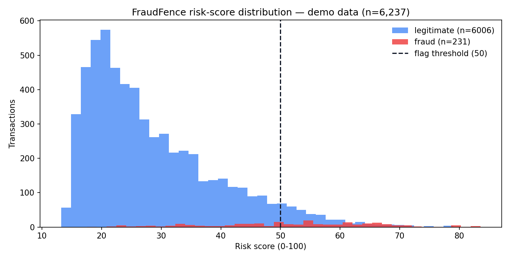
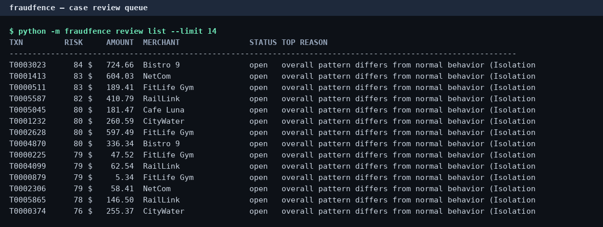

# 🛡️ FraudFence

**Transaction fraud detection with anomaly scoring and case review — runs 100% offline, no API keys.**


FraudFence scores every card transaction with a **0–100 risk score** built from
two complementary signals — hand-rolled **z-score anomaly features** computed
per customer, and a scikit-learn **IsolationForest** over engineered behavioral
features — then explains each flag with human-readable reasons and routes it
into a **case-review queue** where analysts confirm fraud or clear it.


## Screenshots

**Risk-score distribution on the bundled demo data (6,237 transactions):**



**Case-review queue in the terminal:**



## Features

- 🎲 **Synthetic transaction generator** — seeded, reproducible stream with
  per-customer spending profiles (favorite merchants, typical hours, spend
  levels) and four injected, *labeled* fraud types: odd-hour spend, amount
  spikes, merchant/category mismatches, and velocity bursts.
- 📊 **Explainable risk scoring** — from-scratch per-customer z-scores +
  IsolationForest, blended into a 0–100 risk score with top reasons per flag
  ("amount 4.2x std-dev above customer's norm; unusual hour (02:00)…").
- 🧾 **Case-review queue CLI** — flagged transactions ranked by risk, decisions
  (`fraud` / `legit`) persisted in SQLite, idempotent and auditable.
- 📈 **Evaluation report** — precision / recall / F1 vs. ground-truth labels on
  a time-based train/test split, printed and saved.
- 🔌 **Fully offline** — no API keys, no network calls, no paid services.

## Tech stack

| Layer | Technology |
|---|---|
| Anomaly detection | scikit-learn `IsolationForest` |
| Statistical signals | from-scratch per-customer z-scores (causal, history-only) |
| Feature engineering | pandas / numpy — velocity, hour unusualness, category & country novelty |
| Case store | SQLite |
| CLI | argparse (`generate`, `score`, `review`, `evaluate`, `demo`) |
| Tests | pytest |

## Quickstart

```bash
git clone https://github.com/872000/fraudfence.git
cd fraudfence
pip install -r requirements.txt

# 1. End-to-end demo: generate data -> train -> score -> evaluate -> review queue
python -m fraudfence demo

# 2. Inspect the highest-risk cases
python -m fraudfence review list --limit 10

# 3. Record an analyst decision (persisted in data/cases.db)
python -m fraudfence review decide T0003023 fraud --reviewer alice

# 4. Score your own transaction file
python -m fraudfence score --in data/demo_transactions.csv --out data/scored.csv

# 5. Evaluate the detector against labels
python -m fraudfence evaluate --in data/demo_transactions.csv

# 6. Run the test suite
python -m pytest
```

Sample evaluation output on the bundled demo data:

```
Precision: 0.457
Recall   : 0.614
F1 score : 0.524
```

## How the risk score works

1. **Causal feature engineering** — each transaction is featurized using only
   the customer's *prior* history (no lookahead): log-amount z-score vs. the
   customer's own spending, hour unusualness, transactions in the last 60
   minutes, time since last transaction, first-seen category/country flags.
2. **IsolationForest** (`contamination=0.03`) trained on the first 70% of the
   timeline scores how unusual the overall pattern is.
3. **Weighted blend** → 0–100:
   `0.35·isolation + 0.25·amount-z + 0.15·velocity + 0.10·hour + 0.10·category + 0.05·country`.
   Transactions scoring ≥ 50 enter the review queue with their top contributing
   reasons attached.

## Project structure

```
fraudfence/
├── fraudfence/
│   ├── __init__.py      # package version
│   ├── __main__.py      # CLI: generate | score | review | evaluate | demo
│   ├── generator.py     # seeded synthetic transaction stream + labeled fraud
│   ├── features.py      # causal per-customer feature engineering
│   ├── detector.py      # z-scores + IsolationForest -> 0-100 risk, reasons
│   ├── review.py        # SQLite case-review queue
│   └── evaluate.py      # precision/recall/F1 vs labels + report
├── tests/
│   └── test_fraudfence.py
├── data/
│   ├── demo_transactions.csv   # bundled labeled demo dataset (seed 42)
│   ├── demo_scored.csv         # demo data with risk scores
│   └── evaluation_report.txt   # latest evaluation metrics
├── docs/images/         # hero banner, risk histogram, review-queue screenshot
├── requirements.txt
├── LICENSE (MIT)
└── README.md
```

## Roadmap

- [ ] Per-customer adaptive thresholds instead of a global cutoff
- [ ] Model persistence format (joblib) + `score` against a frozen model in CI
- [ ] Precision/recall curve and threshold-tuning helper
- [ ] Web dashboard for the review queue (FastAPI + htmx)
- [ ] Streaming mode: score transactions as they arrive via stdin/websocket

## License

MIT — see [LICENSE](LICENSE).
